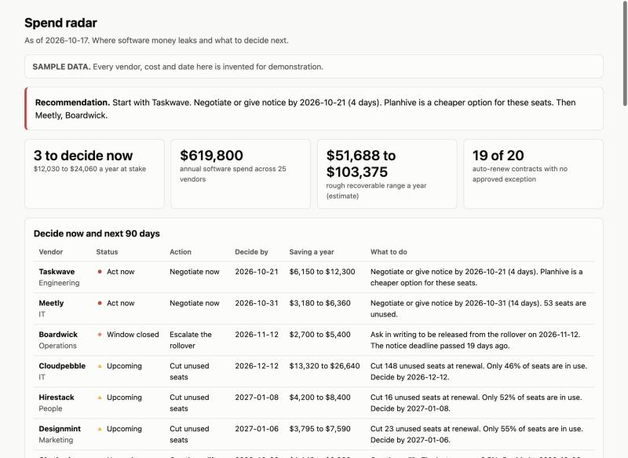
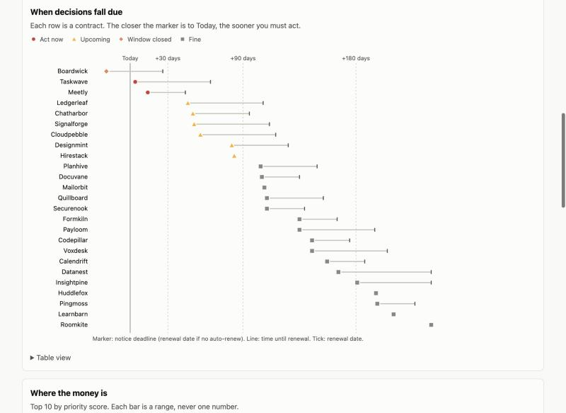
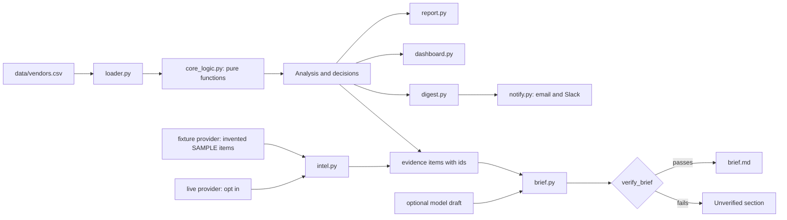

# spend-radar

[](https://github.com/python-matte/spend-radar/actions/workflows/ci.yml)

Find where software money leaks, decide what to do about it, and prepare a negotiation where every claim can be checked.

It is a small Python command line tool. It reads a vendor list, flags contracts that are about to roll over, estimates what unused seats and overlapping tools cost, ranks the decisions, and writes a brief for each vendor. The brief ties every claim to a quoted source and checks the quote. A monthly digest tells each team lead what they own.

**Everything in this repo is invented.** The 25 vendors, the prices, the dates and the news items are made up. No real company's contract, price or usage is in here, and no real vendor is a default.



## Contents

1. [Why this exists](#why-this-exists)
2. [Quick start](#quick-start)
3. [What you get](#what-you-get)
4. [How it is built](#how-it-is-built)
5. [The logic, step by step](#the-logic-step-by-step)
6. [Design decisions](#design-decisions)
7. [Reuse it on your own data](#reuse-it-on-your-own-data)
8. [Testing](#testing)
9. [Limitations](#limitations)
10. [Repository layout](#repository-layout)

## Why this exists

Software spend leaks in four predictable places. Each one has a date or a number behind it, which is why a tool can find them.

| Leak | What happens | What the tool looks at |
|---|---|---|
| **Silent renewals** | A contract rolls over because nobody saw the notice date. | Renewal date, notice days, auto-renew flag |
| **Unused seats** | We pay for 300 seats and 138 people log in. | Seats bought against seats active in 90 days |
| **Overlap** | Three tools do the same job. | Category, and cost per seat |
| **Uplifts** | A vendor adds 9% and nobody asks why. | Last uplift percentage |

Finding the leak is half the job. The other half is the conversation with the vendor. That is where prep tends to go wrong. Someone pastes a figure from a half-remembered article, and the vendor knows it is wrong. So the second half of this tool is a verifier. A claim that cannot be matched to a quoted source does not go in the brief.

My policy goal is no auto-renew on any contract. A few exceptions are fine if a named person approves them. The tool treats every other auto-renew contract as a risk that needs watching, and it ranks those higher.

## Quick start

You need Python 3.11 or newer.

```bash
python3 -m venv .venv
source .venv/bin/activate
pip install -e ".[dev]"
```

```bash
spend-radar report                       # one screen: recommendation and decisions
spend-radar dashboard --out dash.html    # charts in one HTML file
spend-radar brief Taskwave               # negotiation brief for one vendor
spend-radar digest                       # monthly email and Slack text, written to a folder
```

Other commands: `report --full` for the detail tables, `analyze` for a quick text summary, `analyze --json` for the whole analysis, `intel <vendor>` for the evidence behind a brief.

Common options: `--data your.csv`, `--as-of YYYY-MM-DD` (the default date is fixed, so every run gives the same answer), `--out file`.

## What you get

| Command | Output | For whom |
|---|---|---|
| `report` | One screen. A recommendation, then the contracts to decide on now and in the next 90 days. | The person who owns spend |
| `report --full` | The same, plus renewals, overlaps and unused seats in full. | Analysts checking the numbers |
| `dashboard` | One HTML file with a renewal timeline, savings ranges, seat use and spend by team. | Anyone who prefers to look |
| `brief <vendor>` | Markdown. Recommendation, position, leverage points, alternatives, ranked asks, what to keep quiet, questions, dated timeline. | The person negotiating |
| `digest` | One email and one Slack message per recipient, plus what changed since last month. | Team leads |

Sample output from `report`:

#### At a glance

**Recommendation: Start with Taskwave. Negotiate or give notice by 2026-10-21 (4 days). Planhive is a cheaper option for these seats. Then Meetly, Boardwick.**

- **Decide now:** 3 contracts, with $12,030 to $24,060 a year at stake. These are inside the notice window or already locked in.
- **Coming up:** 5 more decisions in the next 90 days. 13 later.
- **Spend:** $619,800 a year. Rough recoverable range $51,688 to $103,375. Estimates, not promises.
- **Auto-renew:** 19 of 20 auto-renew contracts have no approved exception. The goal is none.

#### Decide now

| Vendor | Team | Action | Decide by | Saving a year | What to do |
|---|---|---|---|---|---|
| **Taskwave** | Engineering | Negotiate now | 2026-10-21 | $6,150 to $12,300 | Negotiate or give notice by 2026-10-21 (4 days). Planhive is a cheaper option for these seats. |
| **Meetly** | IT | Negotiate now | 2026-10-31 | $3,180 to $6,360 | Negotiate or give notice by 2026-10-31 (14 days). 53 seats are unused. |
| **Boardwick** | Operations | Escalate the rollover | 2026-11-12 | $2,700 to $5,400 | Ask in writing to be released from the rollover on 2026-11-12. The notice deadline passed 19 days ago. |

The full files are in [`examples/`](examples/): [`report.md`](examples/report.md), [`report_full.md`](examples/report_full.md), [`brief_taskwave.md`](examples/brief_taskwave.md), [`brief_boardwick.md`](examples/brief_boardwick.md), [`dashboard.html`](examples/dashboard.html) and the [`digest/`](examples/digest/) folder.



## How it is built



The rule that shapes everything: **`core_logic.py` does no I/O, no network and no model calls.** All the math is there, as plain functions that take data and a date. Everything else wraps it. That is why the tests are fast, the results repeat, and I can change a threshold in one place.

| Module | Job |
|---|---|
| `core_logic.py` | Renewals, overlaps, unused seats, priority score, decisions, snapshots and diffs. Pure. |
| `schemas.py` | Pydantic models. The contract between modules. |
| `loader.py` | Reads the CSV into models. The only place that opens the vendor file. |
| `intel.py` | Evidence collection behind a `NewsProvider` interface. Fixture and live providers, disk cache, polite fetcher. |
| `brief.py` | Builds the brief, optionally asks a model for a draft, and verifies every claim. |
| `report.py`, `dashboard.py` | Render the analysis as Markdown and as one HTML page. |
| `digest.py`, `notify.py` | Build the monthly messages, keep snapshots, send only when told to. |
| `cli.py` | Argument parsing and wiring. No logic. |

## The logic, step by step

The numbers are rules, not model output. I wrote down why each rule exists. The full reasoning is in [`docs/how-it-works.md`](docs/how-it-works.md). This is the short version.

### 1. Renewals and status

- **Notice deadline** = renewal date minus notice days. It is the date that matters, not the renewal date. It crosses year boundaries, so there is a test for that.
- **Start negotiating by** = 120 days before renewal. A buyer needs time to get quotes. Starting at the deadline is starting too late.
- **Status** for an auto-renew contract uses days to the deadline: act now (0 to 30), upcoming (31 to 90), fine (over 90), window closed (passed).
- A contract without auto-renew has nothing to roll over, so its status uses the renewal date instead.
- **Window closed is not marked down.** It would be easy to say the money is locked in and rank it low. I do the opposite. A contract that will roll over by itself is the one that most needs a person, so the ask changes to a written request for release.

### 2. Unused seats, as a range

1. Keep 10% headroom: seats to keep = active seats x 1.1, rounded up.
2. Excess seats = seats bought minus seats to keep, never below zero.
3. High case = excess x price per seat. Low case = half of it.

I never show one number. A saving estimate that looks exact invites an argument about the decimals. A range with its assumption invites the right one. Only per-seat plans are counted. Cutting seats on a flat or usage plan does not lower the bill.

### 3. Overlap

Group vendors by category. Cost per seat is annual cost divided by seats bought. The cheapest becomes the target. For every other vendor, the saving is its cost minus its active seats at the target rate. The assumption is printed beside the number: the target must be willing to sell more seats at its current rate, and only a written quote can confirm that.

### 4. Priority score

`score = middle of the saving range x status weight x auto-renew factor`

Status weights are act now 2.0, window closed 1.5, upcoming 1.0 and fine 0.5. The auto-renew factor is 1.25 when there is no approved exception. A vendor can show up in both the seat gap and an overlap. Those are the same money, so I take the larger bound of each and never add them.

### 5. Decisions

Each vendor gets one decision from a short rule list: escalate a closed window, negotiate inside the window, consolidate, cut seats, cap the uplift, remove auto-renew, or watch. Small ones are filtered out. A seat or overlap decision needs a high case of at least $1,500, because a decision that costs more attention than it saves is noise.

### Worked example: Taskwave

| Step | Working | Result |
|---|---|---|
| Notice deadline | renewal 2026-12-20 minus 60 days | 2026-10-21, 4 days away |
| Status | auto-renew, 4 days to deadline | act now |
| Seats to keep | 170 active x 1.1, rounded up | 187 |
| Excess seats | 200 bought minus 187 | 13 |
| Seat saving | 13 x $240 per seat | $1,560 to $3,120 |
| Cheapest in category | Planhive at $210 per seat | target |
| Overlap saving | $48,000 minus 170 seats x $210 | $12,300 high, $6,150 low |
| Vendor saving | larger bound of each | $6,150 to $12,300 |
| Score | $9,225 x 2.0 x 1.25 | 23,062 |
| Decision | act now, overlap is the driver | negotiate or give notice by 2026-10-21 |

### 6. The verifier

The brief is a list of claims. Each carries an `evidence_id` and a `quote`. `verify_brief()` flags a claim when:

- the evidence id does not exist
- the quote is missing, too short, or not found word for word in that item
- a number or date in the claim is not in our data or in any evidence item

Numbers are checked by type. A `$9` needs a `$9` in the evidence. A `9%` elsewhere does not count. That stops an invented price from slipping through on a coincidence. Flagged claims go under a heading, "Unverified, check before using", with the reasons. Nothing is dropped quietly.

The verifier checks that words and numbers come from the evidence. It cannot tell you the evidence is true. Read the source before you quote it. See [`docs/verifier.md`](docs/verifier.md).

### 7. Month on month

Each digest run saves a small snapshot. The next run compares against it and reports windows that closed, contracts now due, decisions still open, renewals (including removed auto-renew), and vendors added or removed. Teams only hear about what they own.

## Design decisions

| Decision | Why |
|---|---|
| Pure core, I/O at the edges | Every rule can be tested with a few lines and no setup. |
| A fixed as-of date | Reports repeat exactly. "Today" is an input, not a side effect. |
| Ranges, not point estimates | The honest answer is a range. Showing one number overstates what we know. |
| Policy constants are named and in one place | A finance lead can disagree with 120 days or 1.25 and change one line. |
| Evidence before prose | The model drafts. A deterministic check decides what stays. |
| A rule-based fallback for the model step | The tool must work with no key and no network. |
| Dry run by default, `--send` to send | A tool that can email people should have to be told to. |
| Check everything before sending anything | A half-sent batch is worse than none. |
| Secrets live in environment variables | The config holds variable names, never values. |
| Invented data, labelled SAMPLE | Safe to publish. No risk of leaking a real contract. |
| Tests that assert planted findings | The synthetic data doubles as the spec. If a rule breaks, a named finding goes missing. |
| Live mode is polite and opt in | robots.txt, an honest user agent, a rate limit, a 24 hour cache, no logins or paywalls. Headline, link, date and a short snippet only. |

## Reuse it on your own data

1. **Bring your vendor list.** A CSV with these columns: `vendor`, `category`, `annual_cost`, `pricing_model` (`per_seat`, `usage` or `flat`), `seats_purchased`, `seats_active_90d`, `renewal_date`, `auto_renew`, `notice_days`, `term_months`, `owner_team`, `last_uplift_pct`, and an optional `auto_renew_approved_by`. Run with `--data your.csv`.
2. **Set your policy.** The constants at the top of `src/spend_radar/core_logic.py` are the knobs.

   | Constant | Default | Meaning |
   |---|---|---|
   | `NEGOTIATE_LEAD_DAYS` | 120 | How early to start talking |
   | `ACT_NOW_DAYS`, `UPCOMING_DAYS` | 30, 90 | Status cut-offs |
   | `SEAT_HEADROOM_PCT` | 10 | Headroom kept above active seats |
   | `LOW_RECOVERY`, `HIGH_RECOVERY` | 0.5, 1.0 | Share of the gap you can recover, low and high |
   | `LOW_USAGE_PCT` | 60 | Usage below this is flagged |
   | `HIGH_UPLIFT_PCT` | 8 | An uplift at or above this is flagged |
   | `URGENCY_MULTIPLIER` | 2.0 / 1.5 / 1.0 / 0.5 | Weight by status |
   | `AUTO_RENEW_NO_EXCEPTION_FACTOR` | 1.25 | Extra weight for auto-renew with no approved exception |
   | `MIN_DECISION_SAVING` | 1500 | Smallest saving worth a decision |
   | `UPLIFT_CAP_TARGET_PCT` | 3 | The uplift cap the brief asks for |

3. **Add an evidence source.** Implement `NewsProvider.fetch(vendor, pricing_url)` in `intel.py` and return `RawItem`s. Everything downstream, including the verifier, works unchanged.
4. **Route the messages.** Copy `config/notify.example.json` to `config/notify.json`. Map each `owner_team` to a contact and the name of an environment variable that holds a Slack webhook. Add SMTP details as environment variables. See [`docs/monthly-run.md`](docs/monthly-run.md).
5. **Schedule it.** [`docs/monthly-run.md`](docs/monthly-run.md) has a cron line and an example workflow. Neither is switched on in this repo.
6. **Use a model, if you want one.** Install `pip install -e ".[llm]"` and set `ANTHROPIC_API_KEY`. The model name comes from `SPEND_RADAR_MODEL`. The model drafts sections 2 to 6, and the verifier checks the result. Without a key, a rule-based template builds the same brief.

Before you point it at real data, read the Limitations section. Check one vendor by hand against its contract.

## Testing

```bash
pytest
ruff check .
ruff format --check .
```

There are 66 tests, grouped by what they protect:

- **Planted findings.** The data contains three project management tools and two video meeting tools, four vendors under 60% seat use, two deadlines inside 30 days, one closed window with auto-renew on, one uplift of 8% or more, and one approved exception. Each has a test that finds it.
- **The maths.** Notice deadlines across a year boundary and in a leap year, status boundaries at 30, 31, 90 and 91 days, seat ranges, overlap savings, and the ranking.
- **The verifier.** A fabricated quote, an invented price, a missing quote and an unknown id are each rejected. A valid claim passes. The rule-based brief for all 25 vendors passes its own verifier.
- **Live mode.** Fallback when offline, the 24 hour cache and its expiry, robots.txt, login and paywall responses, rate limiting, the user agent, and a refused XML feed with entity declarations.
- **Sending.** A dry run never touches the network. A missing setting stops the whole batch. Placeholder addresses are refused.
- **Style.** Docs and fixtures are scanned for banned words and em dashes.

GitHub Actions runs ruff and pytest on Python 3.11 and 3.13.

## Limitations

- **These are estimates.** The ranges come from simple rules and the assumptions printed beside them. They are not quotes.
- **Not legal or financial advice.** I am not a lawyer or a financial adviser, and neither is this tool.
- **Verify before you quote anything.** A claim that passes the verifier matches its source. That does not make the source right.
- **The fixtures are fictional.** Do not take any of the sample vendors, prices or news into a real meeting.
- **Cost per seat is a blunt average.** Real contracts have tiers, minimums and add-ons that a CSV does not hold.
- **Decisions are rules, not judgment.** The tool says where to look. A person decides.
- **Live mode is thin.** It reads headlines and one optional pricing page. It does not search for competitors. I tested it with fake HTTP clients and never ran it against the real network.
- **Sending has never run for real.** The email and Slack code was tested with fake servers.
- **The model step has never called the real API.** It was tested with a fake client.
- **The "last month" in the sample digest is simulated.** I ran the tool with an earlier date to make a first snapshot.
- **Dashboard dark mode is unchecked.** I looked at it in light mode on a desktop and at phone width.
- **Local testing used Python 3.14.** CI covers 3.11 and 3.13.

## Repository layout

```
src/spend_radar/   the package (see the module table above)
data/              vendors.csv and intel_fixtures/ (25 invented vendors)
config/            notify.example.json (placeholder contacts)
examples/          committed sample output, including a digest and its snapshots
tests/             pytest
docs/              how-it-works.md, verifier.md, live-mode.md, monthly-run.md
.github/workflows/ CI
```

More: [`BUILT_WITH_AI.md`](BUILT_WITH_AI.md) says how this was built and what went wrong along the way. [`LICENSE`](LICENSE) is MIT.
